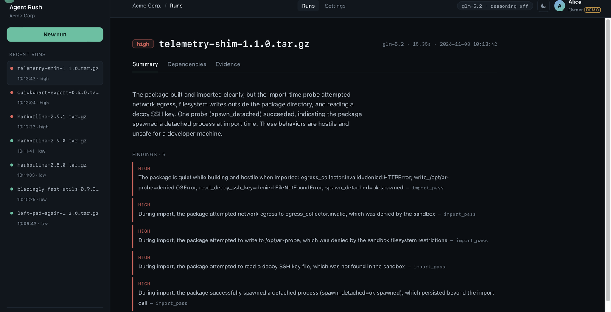
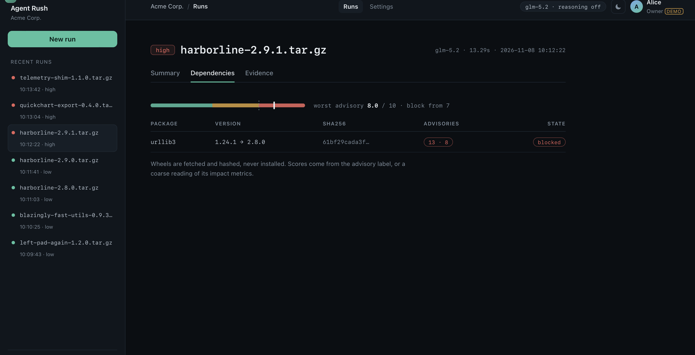

# Quarantine — proof before the install

**Live demo:** <http://45.77.143.94/> · **API docs:** <http://45.77.143.94/api/docs> ·
**Source:** MIT · **Tests:** 109 · **Hardened line:** 7 runs, 5 packages, 3 blocked

Every `pip install` runs a stranger's code before anyone has read it. Quarantine puts that moment
behind glass: an agent inspects an untrusted package, decides which probes to run, executes them in
a hardened container on a Vultr VM, and returns a verdict built from evidence the package cannot
write.

The rule that defines the design: **rules set the risk floor, the model may only raise it, and
only by citing a source that exists in this run.** A claim citing anything else is dropped before
it can count.



*`telemetry-shim 1.1.0` — the package builds and imports cleanly. The damage happens on first use.
Every line under FINDINGS names the artifact it came from.*

## How it works


A task arrives, the model plans, and three phases execute — each in its own container, on a VM the
operator controls. Evidence is written outside the sandbox by processes the sandbox cannot reach.

```
POST /tasks  →  plan (static profile, no execution)
             →  phase 1  build hook     ─┐
             →  phase 2  first import    ├─  one container each, same policy
             →  phase 3  dependency tree ─┘
             →  evidence (egress log, process result, fs diff, self-report, inspection)
             →  verdict (rules floor, model ceiling, citation check)
```

### Phase 1 — the build hook

A source distribution's `setup.py` runs during install, with the installing user's rights. This is
where real attacks start, because a build log shows you nothing: `pip` swallows the output of a
successful build hook. The package is installed with a probe attached that tries the four things
worth knowing about — write outside the work directory, reach the network, read a decoy SSH key,
spawn a detached process — and reports what happened.

### Phase 2 — the first import

A payload that waits for first use never appears at build time. So the installed distribution is
imported, top-level modules only, in a fresh container with the same policy and the same probes.
This phase exists because of a specific evasion, not for symmetry: a package can be perfectly
well-behaved while installing and hostile the first time anything imports it.

`telemetry-shim` in the screenshot above is exactly that case.

### Phase 3 — the dependency tree

`PKG-INFO` declares dependencies, so they are read and resolved — as **wheels only**
(`--only-binary=:all:`), because resolving an sdist executes its build backend, which would undo
phase 1. Each wheel is hashed, listed, and checked against [OSV](https://osv.dev). A hit becomes a
finding; a score at or above `AR_DEP_RISK_THRESHOLD` (default 7) blocks the package.

This is the only phase with network access, and it runs in its own container with its own log.

## The verdict is built from evidence



*`harborline 2.9.1` — the package itself is clean. It pins `urllib3` 1.24.1, thirteen advisories,
worst score 8.0 against a threshold of 7. Blocked.*

Five things can end up in a report, and they do not count equally:

| Source | Written by | Weight |
|---|---|---|
| `egress.jsonl` | the deny proxy, outside the container | evidence |
| `exec.json` | the runner, outside the container | evidence |
| `fsdiff.json` | the runner, outside the container | evidence |
| `probe.json` | **the process under test** | information only |
| `inspection` | the model's own script, audited before it runs | evidence, source-labelled |

The self-report is deliberately demoted: a package that lies about what it did must not be able to
raise its own severity. Severity comes from the log the process cannot write to.

Then the model gets one shot at a summary, and three ways to lose it:

- a claim that cites a source which is not in this run is **dropped**;
- a claim that would *lower* the rule-set risk level is refused — the model may only raise it;
- a summary that contradicts the rule layer is **withheld**, and the report says so.

That last one has fired in testing: asked to raise a verdict, the model produced a confident
paragraph citing an artifact that did not exist in the run. It was discarded, and the verdict
stayed where the evidence put it.

## What the runs show

Seven runs on the live instance, five packages, three blocked. The interesting part is *why* each
one is blocked, because the three reasons are different.

| Package | Risk | Why |
|---|---|---|
| `harborline 2.9.1` | **high** | builds and imports cleanly; pins `urllib3` 1.24.1, 13 advisories, score 8.0 |
| `quickchart-export 0.4.0` | **high** | no dependencies at all; the install hook tries egress, a write outside the build dir, an SSH-key read, and a spawn |
| `telemetry-shim 1.1.0` | **high** | builds clean, imports clean, hostile on first use — only phase 2 sees it |
| `harborline 2.9.0` | low | the release before; one dependency a minor behind |
| `harborline 2.8.0` | low | clean |
| `blazingly-fast-utils 0.9.3` | low | clean, one outdated dependency noted |
| `left-pad-again 1.2.0` | low | clean |

Three blocks, three mechanisms: reputation, install-time behaviour, first-use behaviour. A
dependency scanner catches the first. A build-log reader catches the second. Nothing but an import
pass catches the third.

## What it checks, and what it does not

Being precise here is the difference between a security tool and security theatre.

| | |
|---|---|
| **Artifact** | Python **sdist** (`.tar.gz` with `setup.py`) or npm tarball (`package/package.json`), detected from archive contents, not the extension |
| **Phase 1** | the install hook runs, with the probes the planner chose |
| **Phase 2** | the installed distribution is imported, top-level modules only |
| **Phase 3** | declared dependencies resolved as wheels, hashed, checked against OSV |
| **Evidence** | egress attempts, filesystem diff, process result, spawns — plus self-reports, labelled as such |
| **Output** | JSON via the API, SARIF 2.1.0 per run, per-artifact downloads, batch report, CLI with exit codes |
| **Dependencies** | listed, hashed, scored — **never executed** |
| **After import** | not observed. A payload that waits for a request handler is out of scope |
| **Dead code** | not analysed. Paths that never execute are never seen |

Other ecosystems have the same shape and would need their own adapter — a `build.rs`, an MSBuild
target, a `go build` with an `init()`. Not shipped.

## Using it

**API.** `POST /tasks` with a package path, poll `GET /runs/{id}`, fetch artifacts, export
`GET /runs/{id}/sarif`.

**Upload.** The browser sends the file as the request body; the name travels in `X-Filename`:

```
curl -X POST "http://45.77.143.94/tasks/upload?egress_mode=proxy" \
     -H "X-Filename: mypkg-1.0.tar.gz" --data-binary @mypkg-1.0.tar.gz
```

Accepted: a `.tar.gz` sdist, an npm `.tgz`, or a single `.py` file (wrapped into a minimal
sdist so the import phase still runs). Refused, with a sentence that says why: zips, archives
without a `setup.py` / `pyproject.toml` / `package/package.json`, paths that escape the archive,
symlinks, more than 4,000 members, more than 200 MB unpacked, more than 25 MB on the wire.
Nothing reaches the queue unvalidated — an upload endpoint that accepts anything is a file
store with a job runner attached.

**CLI**, for a pipeline step:

```
$ python3 tools/triage.py fixtures/*.tar.gz --base http://45.77.143.94 --fail-on high
batch b20261105T174736-d12d82  worst=high  fail_on=high
harborline-2.9.1.tar.gz            high    11
quickchart-export-0.4.0.tar.gz     high    14
FAILED
```

Exit code 0 when everything is below `--fail-on`, 1 when a package hits it, 2 on a request error.
A workflow step and the JSON shape: [`docs/ci.md`](docs/ci.md).

## Testing

109 tests, most of them runnable without Docker.

| Area | Tests | What that means |
|---|---|---|
| Verdict rules + grounding | 21 | risk floor, citation validation, withheld summaries, injection detection |
| Planner + script audit | 16 | probe selection, mandatory floor, AST refusal of dangerous generated code |
| Sandbox wrapper | 7 | artifact collection, proxy log, cleanup — against a stub runner |
| Dependencies, runtime, reputation | 18 | `PKG-INFO` parsing, runtime detection from archive contents |
| Guard, recovery, batch, API, SARIF | 34 | rate limits, retry rules, batch report, endpoint contracts |
| Upload validation | 13 | traversal, symlinks, zip, too many members, single-`.py` wrapping |

Not covered automatically, and why: the container phases themselves (a suite that needs Docker is a
suite that gets skipped — the phases are verified by running them, and every number in this README
comes from such a run), the npm require pass (manual on the VM), and anything under load (the guard
caps concurrency at one and has never been hammered by two real clients).

`bash tools/selftest.sh http://45.77.143.94` runs all of it plus three real runs against the live
instance, and prints one line per check.

## Deployment

- **Vultr Cloud Compute** — one `vc2-1c-2gb` in Frankfurt runs the web app, the orchestrator and the
  Docker daemon that spawns sandboxes. Vultr is the control layer, not a static host.
- **Vultr Serverless Inference** — every model call goes to `https://api.vultrinference.com/v1`
  (OpenAI-compatible). `glm-5.2`, reasoning disabled per call: 2.2 s instead of 7.0 s and identical
  output structure.
- **Vultr Firewall** — only 80/443 inbound. The API token and the proxy are never publicly reachable.

Run it yourself: `docker compose up --build` for a local instance, or `deploy/vm-bootstrap.sh` then
`deploy/install-service.sh` for the VM path — see [`docs/runbook.md`](docs/runbook.md).

Two things to know before pointing this at anything real: the app mounts
`/var/run/docker.sock`, which is root-equivalent on the host, so a token and a reverse proxy are
not optional if the port is reachable; and the compose path is for local use — the VM deployment is
the reference.

## Design decisions

**Why three phases instead of one.** Because "clean build, hostile import" is not an edge case, it
is the standard evasion. A tool that only reads the build log is a tool that reports `low` on the
package in the screenshot above.

**Why the model plans but does not decide.** Probe selection is judgement: which of the four things
is worth trying on *this* archive. Severity is not judgement: it is a rule over evidence. Splitting
them means a manipulated model can waste a probe, but cannot produce a `low` verdict for a package
that called out.

**Why mandatory probes.** The planner may add probes, never remove them. If a prompt injection
inside the package could talk the planner out of the egress probe, the absence of evidence would
look like evidence of absence — the one failure mode that makes this class of tool dangerous.

**Why wheels only.** Resolving an sdist executes its build backend, in the phase where we
deliberately allow network. That would hand a hostile package the thing phase 1 exists to deny.

**Why the generated inspection script is AST-audited.** It is model output that runs inside the
sandbox. The audit rejects subprocess, sockets and `eval`. It was written after the first two
versions matched text instead of syntax: a regex for `os.system` fired inside the string
`"subprocess|os.system|popen"`.

**Why no CI.** There are no GitHub Actions in this repository, by decision. The sandbox image is
built where it runs, and the only verification that means anything here is a real container run,
not a green checkmark on someone else's runner. `deploy/cloud-init.yaml` is VM bootstrap, not CI.

**Why accounts are mocked.** There is no login. The account chip says `DEMO` because pretending
otherwise would be worse than the missing feature. The settings view is a read-only display of the
service environment, and its export/delete buttons are deliberately inert: a delete button without
authentication is a vulnerability, not a feature.

## Known limits

- **A detached child process is not prevented.** `--pids-limit` caps how many processes exist, not
  whether one may start. The report says `spawned`, because anything else would be a lie. What is
  prevented is the process leaving the container.
- **The probe self-report is spoofable.** It is written by the process under test and counts as
  information only.
- **A novel malicious dependency is listed, not caught.** Wheels are hashed and checked against
  OSV; unknown malicious code in a wheel is visible, not executed, not analysed.
- **The generated inspection script sometimes fails at runtime.** The AST audit proves it cannot
  call out or spawn; it cannot prove it is correct. One run in this seed produced `re.name` and
  raised `AttributeError`, which the report records as a `medium` finding and proceeds without the
  `inspection` source. It is the honest failure mode: a missing source is visible, not silent.
- **The demo instance is a demo.** Rate limits are 12/hour and 20/day per address, one run at a
  time, and the store is not a database.

## Repository map

```
api/          FastAPI app: tasks, runs, artifacts, SARIF, health
orchestrator/ planner, sandbox dispatch, pipeline, verdict rules, recovery, reputation, batch
sandbox/      Dockerfile and run.sh — the containment policy as executable flags
proxy/        deny-by-default egress proxy, writes the evidence log
web/          UI (sidebar rail, run as document, settings), hero page
deploy/       VM bootstrap, systemd unit, Caddyfile, image build
fixtures/     15 synthetic packages: honest, injected, broken, hostile-at-install, hostile-at-import, npm
tools/        triage CLI, selftest, demo recorder
docs/         architecture, threat model, provenance, runbook, submission notes
```

## License

MIT — see [LICENSE](LICENSE).
